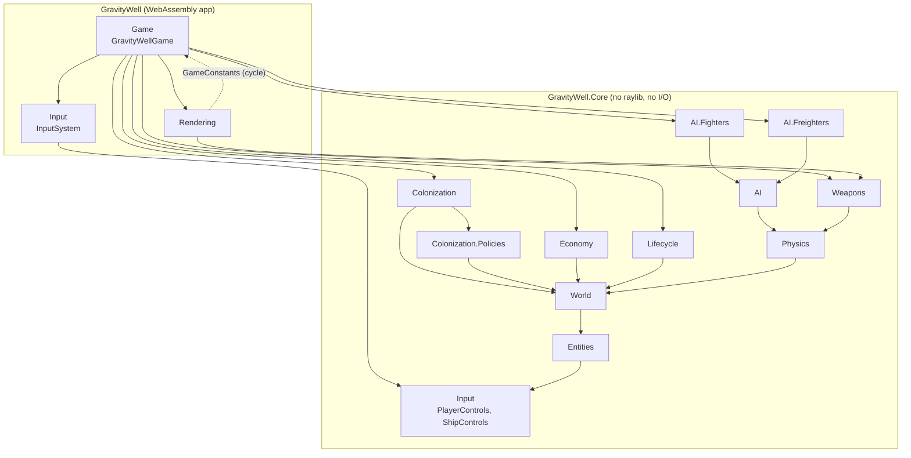
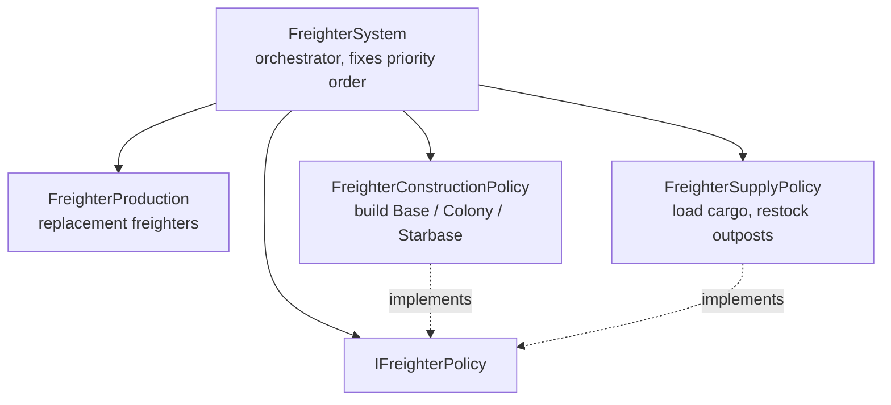

# System dependencies

How the subsystems depend on each other, and which direction each dependency is allowed to point.
Complements [ADR 0004](../adr/0004-separate-state-systems-and-renderers.md), which sets the rule that state, systems
and renderers stay separate.

An arrow means **"depends on"** (`A --> B`: A uses B's types; B knows nothing about A).

## Namespace layers

The diagram shows the *transitive reduction*: if `AI --> Physics` and `Physics --> World`, the direct `AI --> World`
edge is left out. The tables below list the direct edges. Derived from the `using` directives and project references.

### Layering rules

| Layer | Namespaces | May depend on |
|---|---|---|
| 0 | `Core.Input` | nothing |
| 1 | `Core.Entities` | `Input` |
| 2 | `Core.World` | `Entities` |
| 3 | `Physics`, `Economy`, `Lifecycle`, `Colonization` (+ `Policies`) | layers 0-2 only |
| 4 | `Weapons`, `AI` | layers 0-3, in practice `Physics` only |
| 5 | `AI.Fighters`, `AI.Freighters` | `AI` and below |
| App | `Game`, `Rendering`, `Input` | all of `Core` |

- **Core never depends on the app.** `GravityWell.Core` has no reference to raylib or to the `GravityWell` project; the
  app, the tests and `FlightSimulation` each reference Core.
- **Layer 3 are peers.** `Economy`, `Lifecycle`, `Colonization` and `Physics` don't use each other. They communicate
  only through shared state in `World` and `Entities`. A new `using` between them is a design smell.
- **`Weapons` and `AI` are the only systems that reuse another system** (`Physics`), and they get it by constructor
  injection, not by reaching for it.

### Direct edges inside Core

| Namespace | Depends on |
|---|---|
| `Input` | none |
| `Entities` | `Input` (`Ship` holds `ShipControls`) |
| `World` | `Entities` |
| `Physics` | `Entities`, `Input`, `World` |
| `Economy` | `Entities`, `World` |
| `Lifecycle` | `Entities`, `World` |
| `Colonization` | `Colonization.Policies`, `Entities`, `World` |
| `Colonization.Policies` | `Entities`, `World` |
| `Weapons` | `Entities`, `Input`, `Physics`, `World` |
| `AI` | `Entities`, `Input`, `Physics`, `World` |
| `AI.Fighters`, `AI.Freighters` | `AI` (parent namespace, no `using` needed), `Entities`, `Input`, `Physics`, `World` |

## Frame pipeline

`GravityWellGame` is the only place that knows the order. Each system takes the `GameWorld` and mutates it; none calls
another system's `Update`, except through injected collaborators.

Injected collaborators: `FreighterAutopilot(docking, physics)`, `FighterAutopilot(docking, physics)`,
`WeaponSystem(physics, weaponSettings)`.

Order is behaviour. For example, `FreighterSystem` advances supply freighters before construction freighters, because
supply reads structure states that a build finishing that tick would change
(see `FreighterSystemTests.SupplyDelivery_SeesStructuresAsTheyWereBeforeThatTicksBuilding`).

## Freighters

Construction is dispatched before supply, so a freighter holding a full load builds before it restocks. A new kind of
freighter job is a new policy added to the array in `FreighterSystem`.

## Known violations

| # | Violation | Why it matters | Suggested fix |
|---|---|---|---|
| 1 | `Game` <-> `Rendering` cycle: `Game` owns the renderer, and `Rendering` reads `GameConstants` (`DesignWidth`, `DesignHeight`) from `GravityWell.Game`. 9 uses in `Viewport`, `StarfieldRenderer`, `RadarRenderer`, `GameRenderer`. | The only cycle in the solution. `Rendering` can't be reasoned about or reused without `Game`. | Move `GameConstants` out of `Game` (for example into the app root or `Rendering`). |
| 2 | `Rendering/GameRenderer.cs` has `using GravityWell.Input;` (the app namespace) but nothing in `Rendering` uses `InputSystem`. The `PlayerControls` it draws comes from `Core.Input`. | An unused edge that also hides the fact that two different `Input` namespaces exist (`GravityWell.Input` and `GravityWell.Core.Input`). | Remove the `using`. Consider renaming the app's namespace to avoid the clash. |

## Keeping this accurate

Regenerate the edge list from the code when a namespace is added or a `using` changes: list each file's
`namespace` and its `using GravityWell.Core.*;` lines, drop self-references, and compare against the tables above.
An architecture test that fails when a layer-3 namespace gains a dependency on another layer-3 namespace would make
these rules enforced instead of documented.
